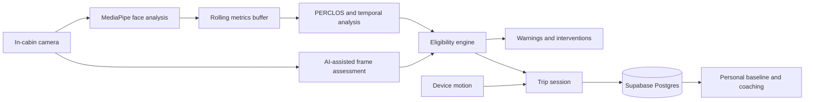

# CogniHood

> Real-time driver-state awareness, fatigue detection, and post-drive coaching—built as a human-centered safety-assistance prototype.


CogniHood combines local facial-landmark analysis with temporal safety signals and AI-assisted interpretation. It estimates driver alertness, detects patterns associated with fatigue or highway hypnosis, recommends safer behavior, and turns completed trips into a personal driving baseline.

> [!CAUTION]
> CogniHood is a prototype—not a medical device, vehicle-control system, or substitute for an attentive driver. It must not be used as the sole basis for deciding whether someone is safe to drive.

## What it does

- Runs a 15-second pre-drive face and alertness check.
- Samples eye closure, blink activity, and head pose with MediaPipe.
- Computes rolling PERCLOS and highway-hypnosis indicators.
- Applies eligibility-state hysteresis to reduce rapid state changes.
- Displays calm, graduated warnings and nearby-stop recommendations.
- Records trip events, safety scores, and coaching suggestions.
- Builds a personal cognitive fingerprint from previous trips.
- Synchronizes authenticated trip history through Supabase.
- Supports anonymous quick start and email/password authentication.
- Provides light, dark, system, and high-contrast display modes.

## How the system fits together



The browser currently performs local MediaPipe analysis and also sends periodic compressed camera frames to Google Gemini for additional interpretation. Review [Security and privacy](#security-and-privacy) before deploying the project.

## Technology

| Area | Implementation |
| --- | --- |
| Interface | React 19, TypeScript, Vite |
| Local vision | MediaPipe Face Landmarker |
| Optional AI interpretation | Google Gemini through an authenticated Supabase Edge Function |
| Spoken alerts | Browser speech synthesis (local) |
| Authentication | Supabase Auth |
| Persistence | Supabase Postgres with Row Level Security |
| Realtime updates | Supabase Realtime |
| Styling | Project design tokens and utility classes |

## Quick start

### Requirements

- Node.js 18 or newer
- npm
- A Supabase project
- A Google Gemini API key stored as a server-side Supabase secret
- A camera-enabled browser served from `localhost` or HTTPS

### 1. Install dependencies

```bash
npm install
```

### 2. Configure the environment

Copy `.env.example` to `.env.local` and provide your own values:

```env
VITE_SUPABASE_URL=https://your-project.supabase.co
VITE_SUPABASE_ANON_KEY=your_supabase_publishable_key
```

Never commit `.env.local`. The Supabase publishable key is designed for browser use when Row Level Security is enabled. Never add a Gemini key to a `VITE_` variable or browser source.

### 3. Initialize Supabase

1. Open the SQL Editor in your Supabase project.
2. Apply both files in [`supabase/migrations`](supabase/migrations) in numeric order. Existing deployments should apply `002_security_hardening.sql` after the original schema.
3. Under **Authentication → Providers**, enable email/password authentication.
4. Enable anonymous authentication only if you want Quick Start and have configured suitable rate limits and abuse protection.
5. If realtime archive updates are required, add `public.trips` to the `supabase_realtime` publication as described at the bottom of the initial migration.

Using the Supabase CLI, the database and protected AI function can be deployed with:

```bash
supabase link --project-ref YOUR_PROJECT_REF
supabase db push
supabase secrets set GEMINI_API_KEY=YOUR_NEW_KEY
supabase secrets set ALLOWED_ORIGINS=http://localhost:3000,https://YOUR_PRODUCTION_DOMAIN
supabase functions deploy gemini-assist
```

Set secrets directly in your terminal or Supabase dashboard; never paste them into source code, commits, issues, or chat. `ALLOWED_ORIGINS` is intentionally local-only until configured for the production domain. The Edge Function authenticates every caller, enforces per-user quotas, limits frame size, times out upstream requests, and validates model output.

The migration creates:

| Table | Purpose |
| --- | --- |
| `profiles` | CogniID and display-name metadata |
| `trips` | Trip summaries, safety events, score timelines, and coaching tips |
| `cognitive_fingerprints` | Per-user historical driving baseline |

All three tables use Row Level Security so authenticated users can access only their own records.

### 4. Start the app

```bash
npm run dev
```

Open [http://localhost:3000](http://localhost:3000), grant camera permission, and choose Quick Start or email sign-in.

### 5. Create a production bundle

```bash
npm run build
npm run preview
```

`npm run preview` is for checking the generated bundle, not for operating a hardened production server.

## Application journey

1. **Authenticate** — Create an account, sign in, or start an anonymous session.
2. **Choose Live Monitoring** — Enter the pre-drive eligibility flow.
3. **Complete the scan** — Keep your face visible while CogniHood establishes a short baseline.
4. **Choose processing** — Continue locally or explicitly opt in to cloud-enhanced analysis for that trip.
5. **Monitor the trip** — Review the safety index, temporal signals, warnings, and safe-stop suggestions.
6. **End the trip** — Save the session and generate coaching insights.
7. **Open Trip Archives** — Explore trends, incidents, national comparisons, and baseline deviations.

## Safety model

CogniHood uses multiple signals rather than treating a single frame as authoritative:

- **EAR:** eye-aspect ratio estimated from local facial landmarks.
- **PERCLOS:** percentage of recent samples in which the eyes appear closed.
- **Blink rate:** locally detected blink events normalized over time.
- **Head-pose variation:** pitch and yaw movement used as an engagement proxy.
- **Gaze stagnation:** sustained low head-pose variance associated with monotony.
- **Highway Hypnosis Index:** combined PERCLOS, stagnation, monotony, blink, and cognitive-load signal.
- **Eligibility hysteresis:** risky transitions happen faster than recovery transitions, limiting state flapping.

These are non-medical behavioral estimates and can be wrong because of lighting, eyewear, camera position, facial differences, network failures, or model behavior.

## Project structure

```text
Cognihood/
├── components/              UI, monitoring panels, pre-drive flow, charts
├── contexts/                Authentication and theme state
├── hooks/                   Realtime data hooks
├── lib/                     Shared utility functions
├── services/
│   ├── faceLandmarker.ts    Local landmarks, EAR, blink, and head pose
│   ├── temporalAnalysis.ts  Rolling fatigue and hypnosis indicators
│   ├── eligibilityEngine.ts State transitions and safety eligibility
│   ├── geminiService.ts     AI frame analysis and generated speech
│   ├── tripSession.ts       In-memory trip event aggregation
│   ├── tripStore.ts         Supabase persistence and export
│   └── baselineService.ts   Historical cognitive fingerprint
├── supabase/migrations/     Database schema and RLS policies
├── App.tsx                  Main application orchestration
├── types.ts                 Shared domain types
└── vite.config.ts           Development and bundle configuration
```

## Security and privacy

The repository includes useful safeguards:

- Supabase Row Level Security scopes records to `auth.uid()`.
- Local environment files are ignored by Git.
- React escapes rendered event and model text.
- Raw frames are not stored in the application database.

The codebase now uses secure defaults:

- Gemini credentials and requests are isolated in an authenticated Edge Function.
- Cloud analysis is disabled by default and requires per-trip consent.
- Local MediaPipe monitoring continues when cloud analysis is disabled or unavailable.
- Failed cloud analysis is never converted into a safe result.
- Model output is validated, clamped, and length-limited on both sides of the trust boundary.
- Trip and event identifiers use cryptographically random UUIDs.
- Database constraints limit numeric ranges, JSON sizes, array lengths, and abusive payloads.
- Runtime CSS and icons are bundled locally; MediaPipe CDN assets use a fixed version.
- Vercel and `_headers` templates provide CSP, framing, MIME, referrer, HSTS, and permissions policies.
- CI runs type checking, tests, a production build, and a production dependency audit.

The application remains a prototype and is **not ready for a safety-critical deployment** without operational review. Before public release, rotate the previously browser-exposed Gemini key, configure the real production origin, verify headers on the deployed response, review Supabase Auth rate limits/CAPTCHA, establish retention and incident-response policies, and complete domain-specific safety and privacy review.

Do not place credentials in issues, commits, screenshots, exported logs, or chat messages. Configure secrets directly through the deployment provider or Supabase secret manager.

## Data lifecycle

- Camera frames stay local unless the driver explicitly enables cloud enhancement for that trip. When enabled, a compressed frame is periodically sent through the authenticated Edge Function to Gemini.
- Derived metrics and trip events are accumulated for the active session.
- Ending a trip writes its summary to the signed-in user's Supabase account.
- Raw camera frames are not included in the `trips` schema.
- **Export** downloads the signed-in user's profile reference, baseline, and trip records as JSON.
- Legacy IndexedDB data is imported only after an explicit ownership warning and confirmation, then deleted locally after a successful upload.

## Troubleshooting

### Camera access is denied

- Use `localhost` during development or HTTPS in deployment.
- Grant camera permission in the browser's site settings.
- Close other applications holding exclusive camera access.

### Supabase shows Offline

- Confirm `VITE_SUPABASE_URL` and `VITE_SUPABASE_ANON_KEY` in `.env.local`.
- Restart Vite after changing environment variables.
- Verify that the migration completed and authentication providers are enabled.

### Pre-drive scan never passes

- Center the face and improve front lighting.
- Remove severe backlighting or camera obstruction.
- Wait for the MediaPipe model to finish loading.
- Check the browser console for model or WASM download failures.

### Trip history does not update live

- Confirm that `public.trips` is part of the Supabase realtime publication.
- Verify that the current session is authenticated.
- Check the browser network panel for Realtime connection errors.

## Responsible development

Changes to scoring, eligibility, warnings, or intervention behavior should include deterministic tests. Avoid claims of medical diagnosis, guaranteed fatigue detection, or guaranteed collision prevention. Human factors, accessibility, privacy, and graceful failure are part of the safety model—not optional polish.

## Verification

```bash
npm run typecheck
npm test
npm run build
npm run security:audit
```

## License

No license file is currently included. Add an explicit license before distributing or accepting external contributions.
