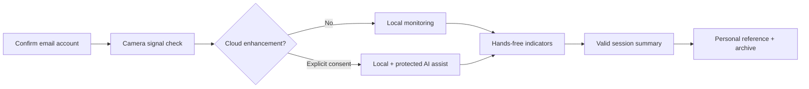
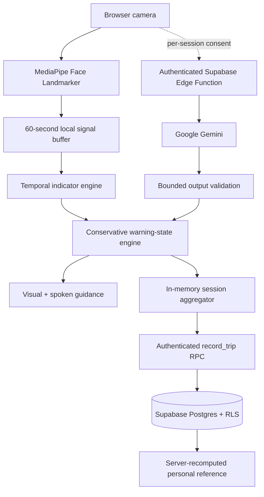

<div align="center">

# CogniHood

### A privacy-conscious attention-support companion for safer driving research

CogniHood turns local camera signals into understandable, conservative attention indicators—without pretending to replace the driver, the vehicle, or professional judgment.

[](https://github.com/Prarth314/Cognihood/actions/workflows/ci.yml)
[](LICENSE)


[Quick start](#-quick-start) · [How it works](#-how-it-works) · [Deploy](#-deployment) · [Security](#-security--privacy) · [Roadmap](#-roadmap)

</div>

> [!IMPORTANT]
> CogniHood is a development prototype. It is not a medical device, navigation service, emergency service, vehicle-control system, or fitness-to-drive determination. Never interact with the screen while driving, and never rely on CogniHood instead of your own judgment or applicable law.

## ✨ The idea

Driver-support technology should be useful without being invasive or overconfident. CogniHood therefore follows three principles:

| Principle | What it means in the product |
| --- | --- |
| **Local first** | Facial landmarks and temporal indicators are processed in the browser by default. |
| **Consent before cloud** | A frame reaches Gemini only when the user explicitly enables cloud enhancement for that session. |
| **Honest indicators** | Experimental estimates, simulated integrations, and synthetic comparisons are labeled as such. |

The result is a web application that explores attention-support experiences while keeping privacy, graceful failure, and product honesty central to the design.

## 🚘 What CogniHood can do

- Run a 15-second camera signal-quality check before monitoring.
- Estimate eye closure, blink activity, and head-pose variation with MediaPipe.
- Calculate rolling PERCLOS and experimental low-engagement indicators.
- Apply hysteresis so warning states do not rapidly bounce between levels.
- Deliver spoken, hands-free attention-risk warnings.
- Continue local monitoring when cloud analysis is disabled or unavailable.
- Save valid session summaries to a user-isolated Supabase account.
- Build a server-recomputed personal reference from previous valid sessions.
- Export account data and permanently delete the account from the product.
- Support light, dark, system, and higher-contrast display modes.

### What it deliberately does not claim

- It does not diagnose fatigue, stress, impairment, or a medical condition.
- It does not certify that a person is safe or unsafe to drive.
- It does not record raw video in the application database.
- It does not control the vehicle. An optional Raspberry Pi deployment can trigger a separate cabin buzzer alert.
- It does not provide live navigation or V2X connectivity.
- Its prototype comparison score is not a national percentile or population benchmark.
- Browser motion classification is experimental and disabled by default.

## 🧭 Product journey



1. **Sign in** with a confirmed email account.
2. **Complete the signal check** with a clear, well-lit camera view.
3. **Choose local-only or cloud-enhanced processing** for that session.
4. **Receive hands-free indicators** while the monitoring view is active.
5. **End the session** to save it if it meets minimum duration and sample requirements.
6. **Review the archive** for trends, events, coaching notes, and clearly labeled prototype comparisons.

## 🧠 How it works



The local pipeline runs continuously while monitoring is active. Optional cloud requests pass through an authenticated Edge Function that validates origin, session, image format, body size, rate limits, model output, and timeouts. A failed cloud call never becomes a “safe” result.

### Signal glossary

| Signal | Meaning | Important limitation |
| --- | --- | --- |
| **EAR** | Eye-aspect ratio estimated from facial landmarks | Sensitive to camera angle, eyewear, lighting, and facial geometry |
| **PERCLOS** | Share of valid recent face samples classified as eyes closed | Not a medical or impairment diagnosis |
| **Blink rate** | Locally observed blink events normalized over time | Short windows can be noisy |
| **Head-pose variation** | Independent pitch and yaw variation | Head pose is not the same as eye gaze |
| **Low-engagement index** | Experimental combination of temporal indicators | Requires independent validation before safety claims |

## 🛠 Technology

| Layer | Technology |
| --- | --- |
| Web application | React 19, TypeScript, Vite 6 |
| Styling | Tailwind CSS 4 and project design tokens |
| Local vision | MediaPipe Face Landmarker |
| Optional AI assistance | Gemini 3.8 Flash through Supabase Edge Functions |
| Authentication | Supabase confirmed email/password authentication |
| Data | Supabase Postgres, Row Level Security, Realtime |
| Hosting | Vercel-ready static application |
| Quality | Vitest, TypeScript, production builds, npm advisory audit |

## 🚀 Quick start

### Prerequisites

- Node.js 22 LTS; supported range is Node 22–24
- npm
- A Supabase project
- A camera-enabled browser running on `localhost` or HTTPS
- A Gemini API key only if cloud enhancement is required

### 1. Install

```bash
git clone https://github.com/Prarth314/Cognihood.git
cd Cognihood
npm install
```

### 2. Configure browser variables

Copy `.env.example` to `.env.local`, then replace the placeholders:

```env
VITE_SUPABASE_URL=https://your-project.supabase.co
VITE_SUPABASE_ANON_KEY=your_supabase_publishable_key
VITE_ENABLE_EXPERIMENTAL_MOTION=false
VITE_ENABLE_HARDWARE_BRIDGE=false
```

> [!WARNING]
> Never place a Gemini key, Supabase service-role key, or Vercel token in a `VITE_*` variable. Vite variables are shipped to the browser.

### 3. Prepare Supabase

Apply the SQL migrations in numeric order:

```text
supabase/migrations/001_initial_schema.sql
supabase/migrations/002_security_hardening.sql
supabase/migrations/003_commercial_integrity.sql
```

Then configure Supabase Auth:

- Enable email/password authentication.
- Require email confirmation.
- Keep anonymous, phone, and social providers disabled unless the product policy changes.
- Configure custom SMTP, CAPTCHA, redirect URLs, and abuse limits before public launch.

Email verification returns users to CogniHood's sign-in form before they enter their password. Apply the exact hosted redirect settings and branded email template in the [email confirmation setup guide](docs/EMAIL_CONFIRMATION_SETUP.md).

### 4. Start development

```bash
npm run dev
```

Open [http://localhost:3000](http://localhost:3000), confirm an email account, sign in, and grant camera permission.

### 5. Verify everything

```bash
npm run check
```

That command runs type checking, all tests, a production build, and the production dependency audit.

## ☁️ Deployment

<details>
<summary><strong>Deploy the Supabase backend</strong></summary>

Install and authenticate the Supabase CLI, then run:

```bash
supabase link --project-ref YOUR_PROJECT_REF
supabase db push

supabase secrets set \
  GEMINI_API_KEY=YOUR_NEW_ROTATED_KEY \
  GEMINI_MODEL=gemini-3.8-flash \
  ALLOWED_ORIGINS=http://localhost:3000,https://YOUR_PRODUCTION_DOMAIN \
  AI_RATE_LIMIT_PER_MINUTE=15 \
  AI_DAILY_LIMIT=2500 \
  AI_GLOBAL_DAILY_LIMIT=100000

supabase functions deploy gemini-assist
supabase functions deploy delete-account
```

`SUPABASE_URL`, `SUPABASE_ANON_KEY`, and `SUPABASE_SERVICE_ROLE_KEY` are normally injected into Edge Functions by Supabase. Keep all server secrets in Supabase—not in the frontend or GitHub.

</details>

<details>
<summary><strong>Deploy the web application on Vercel</strong></summary>

1. Create a Vercel project under the **Cognihood** team.
2. Select the Vite framework preset.
3. Use `npm run build` as the build command and `dist` as the output directory.
4. Add these variables to Preview and Production:

```env
VITE_SUPABASE_URL=https://your-project.supabase.co
VITE_SUPABASE_ANON_KEY=your_publishable_key
VITE_ENABLE_EXPERIMENTAL_MOTION=false
```

5. Connect automatic deployments to `main`.
6. Add the production URL to `ALLOWED_ORIGINS` in Supabase secrets.

Do not add the Gemini key or Supabase service-role key to Vercel.

</details>

For the Raspberry Pi 5 kiosk, local GPIO alert bridge, and systemd/autostart setup, see the [Pi deployment guide](docs/RASPBERRY_PI_5_SETUP.md). Keep `VITE_ENABLE_HARDWARE_BRIDGE` disabled for ordinary web deployments.

### Database responsibilities

| Object | Responsibility |
| --- | --- |
| `profiles` | Minimal account-facing CogniID and display name |
| `trips` | Bounded session summaries, provenance, indicators, and coaching notes |
| `cognitive_fingerprints` | Server-recomputed personal reference |
| `consent_records` | Immutable cloud-frame-processing consent records |
| `ai_rate_limits` | Per-user Gemini request limits |
| `ai_global_rate_limits` | Global AI budget circuit breaker |
| `record_trip` | Authenticated, validated session insertion |

## 🔐 Security & privacy

CogniHood uses defense in depth:

- Supabase RLS isolates user-facing records by `auth.uid()`.
- Trip insertion uses an authenticated RPC; direct client inserts and updates are revoked.
- Historical references are recomputed by the database instead of written by the browser.
- Gemini credentials exist only in Supabase Edge Function secrets.
- Cloud processing is disabled by default and requires per-session consent.
- Users can disable cloud analysis during a session.
- Raw frames are not stored in the application database.
- Request bodies, JPEG frames, JSON arrays, numeric ranges, and model output are bounded and validated.
- Per-user and global rate limits provide abuse and cost controls.
- CSP, HSTS, anti-framing, MIME, referrer, and browser-permission headers are configured.
- Export avoids embedding the raw Auth UUID, and account deletion is available in-product.
- Local environment files, recordings, generated output, and Vercel metadata are excluded from Git.

Read the [commercial-readiness notes](docs/COMMERCIAL_READINESS.md) before operating a public environment. The website now includes a complete development-stage [legal center](public/legal.html) with privacy, notice-at-collection, terms, safety, AI transparency, acceptable-use, analytics/storage, provider, copyright, accessibility, and MIT-license pages. These are operational drafts—not a substitute for counsel—and still require verified operator details and jurisdiction-specific approval before commercial launch.

### Data lifecycle

1. Camera-derived landmarks remain local by default.
2. With explicit consent, compressed frames are sent periodically to the protected AI function.
3. Derived indicators accumulate only for the active in-memory session.
4. Sessions shorter than 30 seconds or with fewer than three score samples are discarded.
5. Valid summaries are inserted through the authenticated RPC.
6. The database recomputes the user’s historical reference.
7. Users can export their data or permanently delete the account and associated records.

## 🧪 Quality gates

| Command | Purpose |
| --- | --- |
| `npm run typecheck` | Validate TypeScript without emitting files |
| `npm test` | Run deterministic unit tests |
| `npm run build` | Produce and validate the deployment bundle |
| `npm run security:audit` | Check production dependencies for known advisories |
| `npm run check` | Run every required verification step |

GitHub Actions runs the same checks for pushes to `main` and pull requests.

## 🗂 Repository map

```text
Cognihood/
├── components/          Interface, monitoring panels, dialogs, and charts
├── contexts/            Authentication and theme state
├── docs/                Commercial-readiness documentation
├── hooks/               Supabase Realtime integration
├── public/              Legal center, privacy, terms, safety, notices, and static assets
├── services/            Vision, temporal analysis, storage, and coaching
├── supabase/
│   ├── functions/       Authenticated Gemini and account-deletion functions
│   └── migrations/      Schema, RLS, quotas, consent, and integrity controls
├── App.tsx              Application orchestration
├── types.ts             Shared domain model
└── vercel.json          Production security headers
```

## 🗺 Roadmap

- [x] Confirmed email authentication and user-isolated storage
- [x] Local-first MediaPipe analysis
- [x] Optional authenticated Gemini enhancement
- [x] Per-user and global AI quotas
- [x] Consent provenance, export, and account deletion
- [x] Server-recomputed personal references
- [ ] Independent human-factors and demographic performance validation
- [ ] Production observability, SLOs, billing alerts, and incident response
- [ ] Counsel-approved privacy policy, terms, and retention schedule
- [ ] Validated data source for distance and vehicle-motion measurements
- [ ] Organization, role, entitlement, and billing model for commercial accounts

## 🤝 Contributing

Issues and focused pull requests are welcome during development. Changes to scoring, warning behavior, privacy boundaries, authentication, or data retention should include tests and a written explanation of their safety and privacy impact.

Please do not commit credentials, `.env.local`, recordings, exported CogniLogs, or personal driving data.

## 📜 License

<div align="center">

[](LICENSE)

### Open to explore. Free to build on. Ready for what comes next.

CogniHood is released under the **MIT License**, a concise and permissive open-source license.

</div>

| You may | You must | Please understand |
| :---: | :---: | :---: |
| ✅ Use, copy, and modify | 📌 Keep the copyright notice | ⚠️ The software is provided without warranty |
| ✅ Distribute and sublicense | 📌 Include the license text | ⚠️ The authors are not liable for damages |
| ✅ Use it privately or commercially |  |  |

> **Copyright © 2026 Cognihood**<br>
> Read the complete legal terms in the [`LICENSE`](LICENSE) file.
