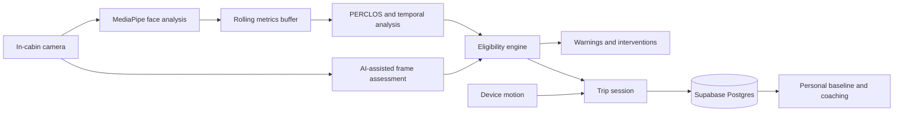

# CogniHood

> Privacy-conscious, camera-derived attention indicators and post-session coaching—built as a human-centered development prototype.


CogniHood combines local facial-landmark analysis with temporal attention indicators and optional AI-assisted interpretation. It provides conservative warnings, records sufficiently long sessions, and builds a personal reference from server-recorded history.

> [!CAUTION]
> CogniHood is a prototype—not a medical device, navigation product, vehicle-control system, emergency service, or substitute for an attentive driver. It does not determine whether anyone is fit to drive. Do not interact with it while driving.

## What it does

- Runs a 15-second camera signal-quality check.
- Samples eye closure, blink activity, and head pose with MediaPipe.
- Computes rolling eye-closure and low-engagement estimates.
- Applies state hysteresis to reduce rapid warning changes.
- Displays calm, graduated attention-risk warnings.
- Records trip events, safety scores, and coaching suggestions.
- Builds a personal reference from valid previous sessions on the server.
- Synchronizes authenticated trip history through Supabase.
- Uses confirmed email/password accounts; anonymous access is intentionally disabled.
- Provides light, dark, system, and high-contrast display modes.

## How the system fits together



The browser performs local MediaPipe analysis continuously. Only after per-trip consent, it sends occasional compressed frames to Google Gemini through an authenticated, rate-limited Supabase Edge Function. Review [Security and privacy](#security-and-privacy) before deploying the project.

## Technology

| Area | Implementation |
| --- | --- |
| Interface | React 19, TypeScript, Vite |
| Local vision | MediaPipe Face Landmarker |
| Optional AI interpretation | Google Gemini through an authenticated Supabase Edge Function |
| Spoken alerts | Browser speech synthesis (local) |
| Authentication | Supabase Auth (confirmed email/password only) |
| Persistence | Supabase Postgres with Row Level Security |
| Realtime updates | Supabase Realtime |
| Styling | Project design tokens and utility classes |

## Quick start

### Requirements

- Node.js 22 LTS (supported range: 22–24)
- npm
- A Supabase project
- A Google Gemini API key stored as a server-side Supabase secret
- A camera-enabled browser served from `localhost` or HTTPS

### 1. Install dependencies

```bash
npm install
```

### 2. Configure the environment

Copy `.env.example` to `.env.local` and provide your own values:

```env
VITE_SUPABASE_URL=https://your-project.supabase.co
VITE_SUPABASE_ANON_KEY=your_supabase_publishable_key
VITE_ENABLE_EXPERIMENTAL_MOTION=false
```

Never commit `.env.local`. The Supabase publishable key is designed for browser use when Row Level Security is enabled. Never add a Gemini key, service-role key, or Vercel token to a `VITE_` variable or browser source. `.env.example` documents every browser, Supabase Function, and optional Vercel CI value.

### 3. Initialize Supabase

1. Open the SQL Editor in your Supabase project.
2. Apply all SQL files in [`supabase/migrations`](supabase/migrations) in numeric order. Existing deployments should apply `002_security_hardening.sql`, then `003_commercial_integrity.sql`.
3. Under **Authentication → Providers**, enable email/password authentication and require email confirmation.
4. Keep phone, anonymous, and social providers disabled. Configure custom SMTP and CAPTCHA before public launch.
5. If realtime archive updates are required, add `public.trips` to the `supabase_realtime` publication as described at the bottom of the initial migration.

Using the Supabase CLI, the database and protected AI function can be deployed with:

```bash
supabase link --project-ref YOUR_PROJECT_REF
supabase db push
supabase secrets set GEMINI_API_KEY=YOUR_NEW_ROTATED_KEY GEMINI_MODEL=gemini-3.8-flash
supabase secrets set ALLOWED_ORIGINS=http://localhost:3000,https://YOUR_PRODUCTION_DOMAIN AI_RATE_LIMIT_PER_MINUTE=15 AI_DAILY_LIMIT=2500 AI_GLOBAL_DAILY_LIMIT=100000
supabase functions deploy gemini-assist
supabase functions deploy delete-account
```

Set secrets directly in your terminal or Supabase dashboard; never paste them into source code, commits, issues, or chat. `ALLOWED_ORIGINS` is intentionally local-only until configured for the production domain. The Edge Function authenticates every caller, enforces per-user quotas, limits frame size, times out upstream requests, and validates model output.

The migrations create:

| Table | Purpose |
| --- | --- |
| `profiles` | CogniID and display-name metadata |
| `trips` | Session summaries, indicators, provenance, consent linkage, score timelines, and coaching notes |
| `cognitive_fingerprints` | Server-recomputed per-user historical reference |
| `ai_rate_limits` | Server-owned per-user AI request counters |
| `ai_global_rate_limits` | Server-owned global AI cost circuit breaker |
| `consent_records` | Immutable cloud-frame-processing consent records |

User-facing tables use Row Level Security. Trip insertion goes through an authenticated database RPC, direct client updates are revoked, and personal references are recomputed on the server.

### 4. Configure Vercel

Create a Vercel project under the **Cognihood** team, set the framework preset to Vite, and add only these browser variables for Production and Preview:

```env
VITE_SUPABASE_URL=https://your-project.supabase.co
VITE_SUPABASE_ANON_KEY=your_publishable_key
VITE_ENABLE_EXPERIMENTAL_MOTION=false
```

Use `npm run build` and `dist` as the output directory. Connect automatic deployments to `main` when the repository is ready to push. Gemini and service-role credentials belong only in Supabase Functions, never Vercel.

### 5. Start the app

```bash
npm run dev
```

Open [http://localhost:3000](http://localhost:3000), create a confirmed email account, sign in, and grant camera permission.

### 6. Create a production bundle

```bash
npm run build
npm run preview
```

`npm run preview` is for checking the generated bundle, not for operating a hardened production server.

## Application journey

1. **Authenticate** — Create a confirmed email account or sign in.
2. **Choose Live Monitoring** — Enter the camera signal-quality flow.
3. **Complete the scan** — Keep your face visible while CogniHood establishes a session reference.
4. **Choose processing** — Continue locally or explicitly opt in to cloud-enhanced analysis for that trip.
5. **Monitor the session** — Receive hands-free attention-risk warnings; screen interaction is not required.
6. **End the trip** — Save the session and generate coaching insights.
7. **Open Trip Archives** — Explore trends, events, personal-reference deviations, and explicitly synthetic prototype comparisons.

## Safety model

CogniHood uses multiple signals rather than treating a single frame as authoritative:

- **EAR:** eye-aspect ratio estimated from local facial landmarks.
- **PERCLOS:** percentage of recent samples in which the eyes appear closed.
- **Blink rate:** locally detected blink events normalized over time.
- **Head-pose variation:** pitch and yaw movement used as an engagement proxy.
- **Gaze stagnation:** sustained low head-pose variance associated with monotony.
- **Low-engagement index:** experimental combination of eye closure, limited head movement, monotony, blink, and cognitive-load indicators.
- **State hysteresis:** warning transitions happen faster than recovery transitions, limiting state flapping.

These are non-medical behavioral estimates and can be wrong because of lighting, eyewear, camera position, facial differences, network failures, or model behavior.

## Project structure

```text
Cognihood/
├── components/              UI, monitoring panels, pre-drive flow, charts
├── contexts/                Authentication and theme state
├── hooks/                   Realtime data hooks
├── lib/                     Shared utility functions
├── services/
│   ├── faceLandmarker.ts    Local landmarks, EAR, blink, and head pose
│   ├── temporalAnalysis.ts  Rolling attention-support indicators
│   ├── eligibilityEngine.ts Conservative warning-state transitions
│   ├── geminiService.ts     AI frame analysis and generated speech
│   ├── tripSession.ts       In-memory trip event aggregation
│   ├── tripStore.ts         Supabase persistence and export
│   └── baselineService.ts   Historical cognitive fingerprint
├── supabase/migrations/     Database schema and RLS policies
├── App.tsx                  Main application orchestration
├── types.ts                 Shared domain types
└── vite.config.ts           Development and bundle configuration
```

## Security and privacy

The repository includes useful safeguards:

- Supabase Row Level Security scopes records to `auth.uid()`.
- Local environment files are ignored by Git.
- React escapes rendered event and model text.
- Raw frames are not stored in the application database.

The codebase now uses secure defaults:

- Gemini credentials and requests are isolated in an authenticated Edge Function.
- Cloud analysis is disabled by default, requires per-session consent, can be disabled during a session, and records consent provenance with the saved session.
- Local MediaPipe monitoring continues when cloud analysis is disabled or unavailable.
- Failed cloud analysis is never converted into a safe result.
- Model output is validated, clamped, and length-limited on both sides of the trust boundary.
- Trip and event identifiers use cryptographically random UUIDs.
- Database constraints limit numeric ranges, JSON sizes, array lengths, minimum valid-session duration, provenance, and abusive payloads.
- Session insertion uses an authenticated RPC; direct client inserts/updates and client baseline writes are revoked.
- Invalid or oversized database JSON is rejected at the runtime boundary instead of being blindly cast.
- Account deletion is handled by an authenticated Edge Function and cascades through user-owned tables.
- Runtime CSS and icons are bundled locally; MediaPipe CDN assets use a fixed version.
- Vercel and `_headers` templates provide CSP, framing, MIME, referrer, HSTS, and permissions policies.
- CI runs type checking, tests, a production build, and a production dependency audit.

The application remains a prototype and is **not ready for safety-critical or fitness-to-drive use**. Before public release, rotate the previously browser-exposed Gemini key, configure the production origin, deploy migrations and both Edge Functions, verify response headers, configure Auth abuse controls/custom SMTP, replace the development privacy/terms pages with counsel-approved documents, establish retention and incident-response policies, and complete independent human-factors and model validation. See [`docs/COMMERCIAL_READINESS.md`](docs/COMMERCIAL_READINESS.md).

Do not place credentials in issues, commits, screenshots, exported logs, or chat messages. Configure secrets directly through the deployment provider or Supabase secret manager.

## Data lifecycle

- Camera frames stay local unless the driver explicitly enables cloud enhancement for that trip. When enabled, one compressed frame is sent through the authenticated Edge Function every 15 seconds normally, every 6 seconds during a warning, and every 4 seconds during a critical state.
- The Edge Function defaults to 15 AI calls per minute, 2,500 per rolling 24-hour user window, and 100,000 globally per rolling 24-hour window. All are server-configurable and must be tuned from production cost and latency telemetry.
- Derived metrics and trip events are accumulated for the active session.
- Sessions under 30 seconds or with fewer than three score samples are discarded instead of being saved as perfect sessions.
- Ending a valid session sends a bounded record through an authenticated RPC; the database recomputes the historical reference.
- Raw camera frames are not included in the `trips` schema.
- **Export** warns about sensitive contents and downloads the account reference, baseline, and session records without embedding the raw Auth UUID in the payload or filename.
- **Delete account** permanently deletes the Supabase Auth user and cascades through CogniHood-owned account data.
- Legacy IndexedDB data is never uploaded automatically. A signed-in user must explicitly import it after an ownership warning; the browser copy is deleted only after a successful upload. Remove the importer after the documented migration window.

## Troubleshooting

### Camera access is denied

- Use `localhost` during development or HTTPS in deployment.
- Grant camera permission in the browser's site settings.
- Close other applications holding exclusive camera access.

### Supabase shows Offline

- Confirm `VITE_SUPABASE_URL` and `VITE_SUPABASE_ANON_KEY` in `.env.local`.
- Restart Vite after changing environment variables.
- Verify that the migration completed and authentication providers are enabled.

### Pre-drive scan never passes

- Center the face and improve front lighting.
- Remove severe backlighting or camera obstruction.
- Wait for the MediaPipe model to finish loading.
- Check the browser console for model or WASM download failures.

### Trip history does not update live

- Confirm that `public.trips` is part of the Supabase realtime publication.
- Verify that the current session is authenticated.
- Check the browser network panel for Realtime connection errors.

## Responsible development

Changes to scoring, eligibility, warnings, or intervention behavior should include deterministic tests. Avoid claims of medical diagnosis, guaranteed fatigue detection, or guaranteed collision prevention. Human factors, accessibility, privacy, and graceful failure are part of the safety model—not optional polish.

## Verification

```bash
npm run typecheck
npm test
npm run build
npm run security:audit
# or run all four checks:
npm run check
```

## License

No license file is currently included. Add an explicit license before distributing or accepting external contributions.
