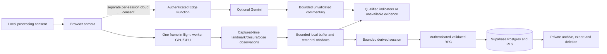

# Attention-support research workflow

CogniHood integrates facial-landmark inference, temporal signal processing and private derived-session storage. It does **not** identify drivers or determine fatigue, impairment, cognitive state or fitness to drive. Software tests establish specific engineering behavior; they do not establish road safety or clinical validity.

The project was developed by Prarth Gupta, a co-PM and a broader team. Prarth's stated contributions include UI/UX and camera/facial analysis. Existing contributor history and MIT licensing are retained; the examples below do not claim sole authorship of team work.

## Workflow and data flow

Sign in → read processing choices → consent to local camera processing → browser permission → 15-second signal check → choose local-only or explicitly consented cloud assistance → monitor qualified indicators → withdraw missing/stale evidence → stop capture → save eligible derived summary → review/export/delete.



No camera frames are intentionally stored in the application database. Browser capture/render buffers and transmitted request bodies are ephemeral processing, not an assertion that memory can never contain a frame. Cloud requests already received by a provider cannot be unsent. Client abort/discard is separate from confirmed server receipt revocation.

## Capability and evidence matrix

These classifications refer to the named checks, not every browser or deployment. Code revision `7b51cc4` was checked on November 2, 2026; current run outcomes are recorded in the verification log below.

| Capability | Classification | Implementation and evidence | Remaining gap |
| --- | --- | --- | --- |
| EAR geometry, bilateral closure, capture times and temporal missing-data rules | Implemented and verified mathematically | `services/faceLandmarker.ts`, `temporalAnalysis.ts`; geometry, known-duration, irregular cadence and missing-face unit tests | Real landmark/detection accuracy unmeasured |
| Worker backpressure, stale replies, capture timeout and cleanup | Implemented and verified for covered cases | `faceTracker.ts`; unit races plus real worker/WASM Chromium tests | Slow devices, browser diversity and long-running recovery |
| Permission pending/denied, late grants and track termination | Implemented and verified with synthetic sources | `cameraLease.ts`; unit tests and `tests/browser/camera.spec.ts` | Physical unplug/revocation/OS camera behavior |
| CPU and main-thread compatibility | Implemented; verification scope differs | Mocked GPU failure→CPU initialization; actual Chromium main-thread processing | Actual GPU delegate/device coverage and fallback on every supported browser |
| Pipeline reset and stopped-session persistence boundary | Implemented and verified for covered cases | Live buffer ordering/bounds; session stop-time unit test; capture disabled before save waits | Human end-to-end session with a suitable face recording |
| Optional cloud consent, revocation and current-evidence separation | Implemented and verified with deterministic/disposable checks | `cloudCommentary.ts`, `cloudConsent.ts`, client abort generation, Edge consent/body tests | Live provider success is not authorized/verified in this batch |
| Per-account records, quotas and deletion | Implemented and verified in disposable infrastructure | Migrations 001–007, real PostgreSQL concurrent writes and both Edge Functions | Hosted project parity and configuration remain unverified |
| Keyboard/contrast and private account workflow | Implemented and automatically checked | Axe light/dark pages; login, pre-drive consent, archive export/delete, sign-out | Manual assistive-technology and human-factors review |
| Closure classification/event evaluation and temporal replay | Implemented and verified using synthetic fixtures | `studyEvaluation.ts`, `evaluate-study.mts`; split leakage and one-to-one event tests | Suitable licensed/consented, independently labelled data |
| Short synthetic performance measurement | Implemented and measured in CI | Real SDK, black 640×480 canvas; metadata, startup, latency, backpressure, timer gaps | Sustained memory, physical camera, CPU model, Pi/mobile measurements |
| Pi alert bridge | Implemented and mock verified | Loopback host/origin/body bounds, cooldown and GPIO cleanup tests | Native binding, electrical mapping and actual device behavior |
| Camera switching | Missing | Retry reacquires the default user-facing camera | No claim of device-selection support |
| Clinical accuracy, demographic fairness and driving clearance | Requires external study; not established | No empirical claim is reported | A separately designed, approved study and independent review |

The cached single main-thread model remains page-scoped; the SDK's own pending model download is not cancellable. Worker initialization is cancellable. Live camera permission requests are also not cancellable: a grant after owner cancellation is immediately stopped without attaching it.

See [the complete signal contract](SIGNAL_CONTRACT.md) for every displayed indicator's inputs, units, windows, minimum evidence, weighting, confounders and non-claims. Thresholds remain engineering settings; this milestone changes evidence handling rather than introducing physiological cutoffs.

## Reproducible offline evaluation

The older JSONL closure summary remains available. The study manifest adds recording provenance/permission records, capture metadata, recorded conditions, annotation protocol, split groups, application/model/configuration versions and observed event intervals.

Run the committed, **synthetic-only** fixture:

```bash
npm exec --yes --package=deno@2.5.6 -- deno run --node-modules-dir=none --allow-read=tests/fixtures scripts/evaluate-study.mts tests/fixtures/study.synthetic.json
```

For private study files, use the ignored `private-evaluation/` directory and grant Deno read access only there. Do not upload recordings, per-person predictions, identifiers or exports to GitHub. Output omits manifest identifiers and source/permission/annotator strings. It includes ordinal records, split, synthetic status and controlled condition categories; small cohorts may still be sensitive, so review private outputs before sharing.

### Labeling and split protocol

1. Obtain recording rights and specific participant consent before collection/use. Store those records privately; `permissionReference` is an audit reference, not proof of consent by itself.
2. Define the task before annotation: this tool supports bilateral-closure decisions and explicitly supplied event onsets. It does not generate human labels or identify people. Blink, head-pose and alert protocols require their own valid definitions/annotations; do not relabel closure agreement as those tasks.
3. Use non-identifying recording, participant-group, session-group and annotator codes. Assign all recordings from the same participant/session to one split. The validator rejects a group appearing in both development and held-out data; correctness of grouping still requires study review.
4. Independently annotate open/closed/unobservable at known timestamps. Define visible eye-closure criteria in advance; record disagreements and adjudication. Do not derive reference labels from the algorithm under evaluation.
5. Tune thresholds only on development data; freeze the commit, SDK/model versions and configuration digest before opening held-out results. Zero-filled version hashes in the committed fixture are explicit synthetic placeholders, not real study provenance.
6. Record capture characteristics and lighting, eyewear and pose conditions. The tool reports these descriptors per record without inferring demographic traits, claiming fairness or presenting an underpowered subgroup study.

### Metrics and boundaries

- Closure precision, recall, specificity/F1 and conditional agreement have explicit confusion counts. Unlabelled references and unavailable predictions are counted separately. Empty denominators return `null`.
- Event matching is one-to-one, maximum-cardinality within a declared onset tolerance; it does not guarantee minimum total matching delay. Matching cannot cross an unobserved interval. Unobserved reference/predicted events are reported separately rather than counted as correct.
- `observedIntervals` must define valid comparison time in the annotation protocol. False alerts/hour divides unmatched predicted events by that time, not whole-file duration. Onset delays are signed; negative means early. p50/p95 use nearest-rank percentiles and report matched-event count. Small event counts do not support strong distribution claims.
- Temporal replay uses the actual `computeTemporalAnalysis` implementation at 500 ms analysis cadence, with immediate missing-signal analysis, and a bounded trailing buffer. It replays supplied decisions/pose, **not** videos through MediaPipe; the supplied EAR proxy is synthetic. Blink replay is not implemented.
- File size is limited to 25 MiB; at most 100 recordings, 100,000 observations/record, 500 events/list and 10,000 observed intervals/record. Segment larger studies deliberately. Input validation and bounds are engineering safeguards, not study-quality guarantees.

The included fixture returned `empiricalMetricsAvailable: false`, one scripted event matched within 200 ms, and coverage withdrawn on the first missing sample. Its perfect scripted closure agreement is not an empirical accuracy result. Real-face metrics, subgroup robustness and confidence intervals remain **unmeasured**. Temporal correlations require an appropriate participant/session-level statistical design rather than treating frames as independent people.

## Device/performance protocol and measured scope

Build `npm run build:test`, serve `node scripts/browser-test-server.mjs`, then use the test-only worker harness. `?mode=main` forces compatibility mode; `?durationMs=120000` requests a longer synthetic run. These fixtures are excluded from normal production builds. No real camera is used.

Keep the browser foreground. Record commit, SDK/model, browser/version, OS, CPU model, memory, power/thermal state, resolution and duration. The harness records the available browser metadata, model startup, capture target cadence, call attempts/completions, busy/stale drops, call-latency percentiles and main-thread timer gaps. Its deliberate overlapping calls exercise backpressure; those drops are **not natural camera frame-loss rates**. Capture target is 10 fps; actual camera capture cadence is not measured by this canvas fixture.

Measurements from [Chromium run 41485989505](https://github.com/Prarth314/Cognihood/actions/runs/41485989505), commit `7b51cc4`, MediaPipe 0.10.35, Headless Chromium 156.0.8078.4, Linux x86_64, 4 reported logical processors, 640×480 black canvas:

| Boundary | Worker | Main-thread compatibility |
| --- | ---: | ---: |
| Model initialization | 450.2 ms | 455.0 ms |
| Synthetic measurement duration | 2,890.4 ms | 3,231.3 ms |
| Attempts / completed | 30 / 19 | 30 / 29 |
| Deliberate busy drops / stale drops / errors | 10 / 1 / 0 | 0 / 1 / 0 |
| Serial call p50 / p95 | 33.3 / 1,225.5 ms | 34.3 / 1,191.2 ms |
| Main-thread 10 ms timer-gap p95 | 10.2 ms | 103.7 ms |

The short trial demonstrates that this worker fixture kept the timer more responsive while processing. It does not show a general inference-speed improvement. The long latency tail and one stale result in each mode remain visible rather than omitted. Startup ends when SDK initialization resolves; latency includes bitmap capture, IPC and processing, and can include lazy first-use work. Ten serial latency observations are too few for a stable p95 claim. Retries and repeated trials with a separate warmup phase are required for a steady-state benchmark.

CPU model and physical RAM were not captured. Chromium reported unchanged JS heap endpoints (10.0 MB worker / 12.7 MB compatibility); these coarse, short JS-heap observations exclude WASM/GPU/process memory and do not establish bounded sustained memory. No Pi/mobile or physical-camera performance result is claimed. Measure those independently in a stationary setting and do not compare runs with different instrumentation boundaries as a speedup.

### Two-minute observation

The optional `Performance sampling` workflow was also executed: [run 41487361608](https://github.com/Prarth314/Cognihood/actions/runs/41487361608), commit `a58e28d`. It used the same 640×480 non-face synthetic source and Chromium/SDK versions above. Recorded virtual environment: Linux x64, kernel 7.0.0-1017-azure, Intel Xeon Platinum 8573C, 4 logical processors, 16,759,308,288 bytes of runner RAM, Node 22.23.4. These are virtual-runner characteristics, not a tested consumer device.

| Measurement | Observed result |
| --- | ---: |
| SDK initialization | 408.8 ms |
| Observation duration | 120,063.6 ms |
| Attempts / completed | 1,596 / 1,063 |
| Deliberate busy drops / stale drops / errors | 532 / 1 / 0 |
| Serial-call latency p50 / p95 | 59.4 / 73.7 ms |
| Main-thread 10 ms timer-gap p95 | 10.5 ms |
| Coarse main-page JS heap at start / end | 10.0 / 10.0 MB |

The test passed, with no tracker errors during this synthetic observation. The unchanged coarse heap is not proof of leak freedom: it excludes worker/WASM/GPU memory, contains instrumentation effects and is only an endpoint comparison. This is a separate trial from the short worker/compatibility comparison, not evidence of a new speedup or face-detection performance. The workflow is explicitly dispatched separately from fast CI; it is not silently skipped inside the critical backend checks.

## Hosted deployment parity checklist

Disposable CI is not proof of production deployment. A read-only probe on November 2, 2026 returned schema metadata `401` and function preflight `404` for both intended endpoints; no records, user tokens or frames were requested. RPC presence and deployed source versions could not be verified. A schema `401` must **not** be interpreted as proof that tables/RPCs are missing.

Before an authorized staging verification:

1. Confirm the correct Supabase organization/project; never use unrelated accessible projects. Use a separate staging project, with explicit authorization for provisioning/configuration. Production modifications remain outside this verification batch.
2. Apply repository migrations **001–007** in order. Compare actual migration versions/checksums, policies, function grants and quota tables to the checkout. A frontend deploy does not apply SQL.
3. Deploy `gemini-assist` and `delete-account`, including all `_shared` imports, using the repository source. Record the source commit and deployed function revision. Check `verify_jwt`, origin allowlist, server-only provider credentials/model, quota settings and client/server timeout bounds. Do not paste secrets into logs or source.
4. Set frontend `VITE_SUPABASE_URL` and the corresponding public anon/publishable key for that same project; never a service-role or provider key. Rebuild after changing Vite build-time values. Confirm the hosted frontend commit matches the tested checkout.
5. Use two disposable confirmed staging accounts. Repeat own/cross-account select/save/export/delete checks, direct-write/private-helper rejection, idempotent retry and concurrent allowance tests. Capture only assertion outcomes, not account identifiers or session content.
6. Verify consent receipt creation/ownership/revocation and rejection of unauthenticated, wrong-origin, oversized and withdrawn-consent requests. CORS is not authentication. Provider-success testing needs separately authorized synthetic content and valid provider configuration; do not send real footage.
7. Check fresh-password deletion requirements, deletion cascades and preservation of the second account. Expired/invalid/recovery freshness claims have deterministic unit tests; do not assume ordinary sign-out instantly revokes every previously issued access JWT. Hosted token-revocation behavior still needs explicit verification.
8. Confirm intended user-controlled retention/export behavior and remove disposable staging data. Email/SMTP setup is a separate owner task and was not changed here.

## Stationary controlled demo

1. Use a trusted, stationary environment with the camera aimed only at a consenting adult. Explain that it is facial-landmark analysis, not identity recognition or a safety assessment.
2. Sign in to a disposable staging account. Show the local-processing notice and default cloud-off choice before enabling the camera. Do not record or upload footage for the demo.
3. Review the browser permission prompt and 15-second signal check. Explain that passing means the implemented signal criteria passed, not that the participant is fit to drive.
4. Start a local-only session. Show the indicator definitions and engineering limitations. Cover/uncover the camera briefly to demonstrate unavailable evidence; never induce fatigue or ask a person to drive.
5. End the session while stationary. Confirm the camera indicator turns off before waiting for storage. A short/insufficient session is deliberately discarded; a sufficiently observed ≥30 s session can be saved.
6. Open the report, export to an approved private location, inspect its scope, delete the session, then sign out. Explain that disposable backend tests cover persistence but hosted parity still needs the checklist above.

## Portfolio wording and remaining dependencies

Suggested résumé bullets, subject to the contributor's own review and the linked verification scope:

- Implemented browser-based facial-landmark and temporal-indicator processing with MediaPipe, worker backpressure, captured-time windowing and explicit stale/missing-evidence handling.
- Built reproducible synthetic evaluation and lifecycle tests, including event matching, study split-leakage checks and CI measurements of worker versus main-thread responsiveness.
- Collaborated on a privacy-conscious React/Supabase workflow with per-session cloud consent, RLS-isolated derived summaries, bounded persistence and disposable integration tests for concurrent quotas and account deletion.

Still required: independently labelled licensed/consented recordings; subject-disjoint held-out evaluation; manual accessibility/human-factors review; sustained physical-camera and target-device profiling; actual Pi validation; correct hosted Supabase access and parity verification; authorized live-provider verification; and owner-approved operating/legal/retention policies. No claims about users, production scale, clinical validity, fairness or safety accuracy follow from this milestone.

## Verification record — November 2, 2026

- Local: 94 unit/domain tests passed, TypeScript passed, production bundle/prerender checks passed, and the production build explicitly rejected inclusion of `dist/tests` or private study data. Root and isolated Pi dependency audits reported no known advisories.
- Deno: both Edge Functions and both offline commands passed type checking; migrations 001–007 applied and additive repairs repeated in isolated SQL tests; synthetic study replay completed with empirical metrics explicitly unavailable.
- [Browser run 41485989505](https://github.com/Prarth314/Cognihood/actions/runs/41485989505): 41 passed, including actual worker/WASM and main-thread compatibility, synthetic camera denial/late-grant cancellation/track termination, accessibility, keyboard and route checks.
- [Backend run 41485989590](https://github.com/Prarth314/Cognihood/actions/runs/41485989590): disposable PostgreSQL/Auth/Edge integration and authenticated browser flow passed. Critical browser checks are asserted not to skip; ordinary public browser runs explicitly exclude the separate backend file rather than claiming it passed.
- Gitleaks: 81 fetched commits scanned with no detected secrets at scan time; repository secret-scanning CI also passed. These are check outcomes, not a guarantee that every vulnerability or sensitive datum has been eliminated.
- Team history/licensing preserved. Email/SMTP, production Supabase data/configuration and real camera footage were not modified or used. Hosted parity remains an external verification dependency rather than a CI-derived deployment claim.
